# Diabetes Digital Twin Platform: In Silico Prediction, 3D Anatomical Simulation & Explainable AI

[](https://www.python.org/)
[](https://fastapi.tiangolo.com/)
[](https://reactjs.org/)
[](https://threejs.org/)
[](https://pytorch.org/)
[](https://github.com/slundberg/shap)
[](https://vitejs.dev/)
[](https://tailwindcss.com/)
[](backend/tests/test_pipeline.py)
[](https://creativecommons.org/licenses/by-nc-sa/4.0/)

An end-to-end, research-grade biomedical AI platform and in silico physiological digital twin for continuous glucose monitoring (CGM), multi-phenotype trajectory forecasting, counterfactual what-if simulation, and interactive 3D human anatomical visualization.

---

## Table of Contents
1. [Executive Summary & Scientific Motivation](#1-executive-summary--scientific-motivation)
2. [Plain-English Guide for Everyday Users ("No Medical Degree Needed")](#2-plain-english-guide-for-everyday-users-no-medical-degree-needed)
3. [Flagship Feature: Professional 3D Anatomical Human Body Digital Twin](#3-flagship-feature-professional-3d-anatomical-human-body-digital-twin)
4. [Platform Architecture & System Pipeline](#4-platform-architecture--system-pipeline)
5. [Mathematical Foundations & Physiological Equations](#5-mathematical-foundations--physiological-equations)
6. [Empirical Dataset Audit Findings](#6-empirical-dataset-audit-findings)
7. [Machine Learning & Deep Learning Benchmarks (11 Models)](#7-machine-learning--deep-learning-benchmarks-11-models)
8. [Clinical Error Grid Analysis & SHAP Explainability](#8-clinical-error-grid-analysis--shap-explainability)
9. [Repository & Directory Structure](#9-repository--directory-structure)
10. [REST API Reference](#10-rest-api-reference)
11. [Quickstart & Local Execution Guide (macOS)](#11-quickstart--local-execution-guide-macos)
12. [Navigating the 9 Platform Modules](#12-navigating-the-9-platform-modules)
13. [Scientific Limitations & Ethical Disclaimers](#13-scientific-limitations--ethical-disclaimers)

---

## 1. Executive Summary & Scientific Motivation

Diabetes mellitus is characterized by impaired endogenous glucose regulation. While modern Continuous Glucose Monitors (CGM) record interstitial glucose every 1 to 5 minutes, raw sensor readings lack causal interpretability and forward counterfactual projection.

This platform bridges computational physiology, biomedical machine learning, and interactive 3D computer graphics:
1. **Track 1: Type 1 Diabetes Physiological Digital Twin (ReplayBG)**: Grounded in the scientific framework of Cappon et al. (*IEEE TBME 2023*), coupling a 2-compartment gut carbohydrate absorption submodel, subcutaneous insulin pharmacokinetics, and a remote insulin action compartment ($X$) to solve patient blood glucose ODEs and execute mechanistic counterfactual what-if simulations.
2. **Track 2: Type 2 Diabetes & Multi-Phenotype Predictive Pipeline (CGMacros)**: Comparative benchmarking across 11 machine learning and deep learning algorithms on 8,276 records from Healthy (`001`), Prediabetes (`008`), and Type 2 Diabetes (`003`) cohorts using PhysioNet CGMacros v1.0.0.
3. **Rigorous Methodological Safeguards**: Zero data leakage via strict chronological partitioning, a 30-minute temporal embargo between training and test sets, and exclusion of all future-derived features (`target_30m`, `target_timestamp`).
4. **Interactive 3D Anatomical Digital Twin**: High-fidelity 3D visualization featuring authentic anatomical GLB models (pancreas with duodenal C-loop, Wirsung duct, stomach, intestines, liver, heart, kidneys, and lungs), 3D flowing InstancedMesh fluid dynamics, real-time 60 FPS differential ODE updates, dual split-screen comparison, and an interactive Organ Dossier inspection panel.
5. **Clinical Validation & Explainability**: Evaluation via Mean Absolute Error (MAE), Root Mean Square Error (RMSE), Mean Absolute Relative Difference (MARD), Clarke Error Grid Analysis (EGA Zones A–E with colored risk circles), Parkes Consensus Grid, Tree SHAP attributions, and local waterfall explanations.

---

## 2. Plain-English Guide for Everyday Users ("No Medical Degree Needed")

If you are not a doctor, medical student, or biomedical engineer, medical terminology can feel overwhelming. This section explains exactly what this platform does in clear everyday language.

### What is a "Digital Twin"?
Think of a Digital Twin as a **virtual flight simulator for your body**:
- Just as a flight simulator lets a pilot test what happens if an engine fails without risking a real plane, this digital twin lets patients and researchers test **"What happens if I eat 80g of carbs instead of 50g?"** or **"What happens if I delay my insulin bolus by 45 minutes?"** without risking dangerous real-world hypoglycemia or ketoacidosis.

### Key Terms in Plain English
- **Blood Glucose (Sugar)**: The fuel circulating in your bloodstream from food. Target safe zone is **70 to 180 mg/dL**. Below 70 is low (hypoglycemia, dizzy/shaky); above 180 is high (hyperglycemia, organ damage over time).
- **Insulin**: The "key" produced by the pancreas that unlocks your muscle and fat cells so glucose can enter and be used for energy.
- **Carbs on Board (COB)**: The amount of carbohydrates still digesting in your stomach and intestines. Like fuel in a funnel waiting to pour into the blood tank.
- **Insulin on Board (IOB)**: Active insulin doses still circulating in your body from previous injections or pump infusions.
- **Renal Glucosuria**: When blood sugar exceeds **180 mg/dL**, the kidneys cannot reabsorb all the sugar, so it begins spilling over into your urine.

### How Healthy, Type 1, and Type 2 Differ
```
Healthy:    [Pancreas Beta-Cells] ---> Brisk Insulin Keys ---> [Muscle Locks Open] ---> Glucose Enters Smoothly (85-125 mg/dL)
Type 1:     [Beta-Cells Destroyed] -> NO KEYS (0 mU/L) ------> [Muscle Locks Closed] -> Glucose Trapped in Blood (Surges >240 mg/dL)
Type 2:     [Overactive Beta-Cells] -> Dense Insulin Cloud ---> [Locks Are Jammed!] --> Glucose Blocked at Muscle (180-230 mg/dL)
```
1. **Healthy**: The pancreas automatically senses food and releases the exact right pulse of insulin within minutes. Blood sugar stays peacefully between 85 and 125 mg/dL.
2. **Type 1 Diabetes**: The body's immune system accidentally destroyed the beta cells in the pancreas. The body produces **zero insulin**. Without manual insulin injections (SubQ), blood sugar climbs uncontrollably into the 200s and 300s, spilling sugar into the kidneys.
3. **Type 2 Diabetes**: The pancreas makes plenty of insulin (hyperinsulinemia), but muscle and liver cell receptors have become **resistant** (like rusted keyholes). Glucose cannot get in easily, leading to stubborn, prolonged high blood sugar after meals.

### How to Read the Charts
- **Dotted Lines**: Historical sensor readings (baseline).
- **Solid Colored Line**: The simulated future trajectory predicted by the Digital Twin.
- **Green Shaded Zone (70–180 mg/dL)**: The healthy target range (Time in Range, TIR).
- **Clarke Error Grid Zones**:
  - **Zone A (Green Circles)**: Clinical bullseye! Accurate prediction that leads to safe treatment decisions.
  - **Zone B (Yellow Circles)**: Minor deviation, but clinically benign (does not cause harm).
  - **Zones C, D, E (Red Circles)**: Dangerous errors that could lead to overtreatment or missed hypoglycemia. The platform models achieve **>90% in Zone A**.

---

## 3. Flagship Feature: Professional 3D Anatomical Human Body Digital Twin

The platform includes a dedicated, medically informed 3D anatomical human simulation (`/anatomy`) that visualizes glucose metabolism across the gastrointestinal, vascular, hepatic, and muscular systems.

```
                      [ Mouth & Esophagus ]
                                │
                                ▼
                       [ Stomach Fundus ]
                                │
                                ▼
         [ Pancreas & Duodenal C-Loop (Islets of Langerhans) ]
                                │
                                ▼
                   [ Small & Large Intestines ]
                                │
            (Mesenteric Absorption via Portal Vein)
                                ▼
                       [ Dual-Lobed Liver ]
                                │
                         (Hepatic Veins)
                                ▼
                    [ Systolic Pulsing Heart ]
                                │
                        (Aorta & Vessels)
            ┌───────────────────┴───────────────────┐
            ▼                                       ▼
 [ Bilateral Kidneys ]                  [ Skeletal Muscle Beds ]
(Glucosuria Spill if G > 180)          (GLUT4 Translocation Sink)
```

### 3.1 Authentic 3D GLB Anatomical Assets
The 3D canvas loads 8 high-resolution GLTF/GLB models with DRACO geometry decompression:
- **`body.glb` (7.9 MB)**: Complete musculoskeletal anatomical reference model from Z-Anatomy (CC BY-SA 4.0), providing 1,872 named nodes, ivory cortical bone shaders, and deep myoglobin muscle tissue (`0x9f1239`).
- **`pancreas.glb` (863 KB)**: BodyParts3D/FMA anatomical model featuring the pancreatic head, body, tail, the glowing electric blue **pancreatic duct of Wirsung** (`0x38bdf8`), and duodenal C-loop.
- **`stomach.glb` (1.1 MB)**: Authentic gastric fundus, corpus, antrum, and esophageal conduit with translucent PBR gastric mucosal rose-crimson shader (`0xe11d48`). Duplicate overlapping placeholder meshes are suppressed to avoid clipping.
- **`intestines.glb` (2.3 MB)**: Detailed enteric convolutions of the jejunum, ileum, ascending, transverse, and descending colon, and taenia coli bands positioned seamlessly below the stomach and duodenal loop.
- **`liver.glb` (12.0 MB)**: Dual-lobed liver with porta hepatis and sinusoidal vascular entry.
- **`heart.glb` (7.2 MB)**: Systolic pulsing cardiac model pumping fluid through aortic and vena caval conduits.
- **`kidney.glb` (7.7 MB)**: Bilateral kidneys with descending ureters connected to the bladder plane.
- **`lung.glb` (16.0 MB)**: Translucent pulmonary lobes framing the thoracic aorta.

### 3.2 True 3D Volumetric Fluid Dynamics
Flow is modeled using hardware-accelerated `InstancedMesh` spheres traveling along 3D Catmull-Rom splines inside translucent vascular conduits:
1. **Glucose Particles (160 spheres)**: Flow from gut mesenteric venules $\rightarrow$ portal vein $\rightarrow$ liver sinusoids $\rightarrow$ heart $\rightarrow$ descending aorta $\rightarrow$ peripheral muscle beds. Velocity and color scale dynamically with glucose level:
   - $G < 140\text{ mg/dL}$: Healthy golden amber (`#fbbf24`)
   - $140 \le G \le 180\text{ mg/dL}$: Cautionary amber (`#f59e0b`)
   - $G > 220\text{ mg/dL}$: Alarming crimson red (`#ef4444`)
2. **Insulin Particles (100 spheres)**: Luminous cyan spheres (`#06b6d4`). Dynamically switches between:
   - **Endogenous Spline**: Originates at pancreatic beta-cell islets $\rightarrow$ portal vein $\rightarrow$ systemic distribution.
   - **Exogenous SubQ Spline**: Originates from the lower right abdominal subcutaneous injection depot $\rightarrow$ capillary bed $\rightarrow$ venous return.
3. **Food Chyme Boluses (40 spheres)**: Warm orange spheres (`#f97316`) traversing the digestive tract from esophagus $\rightarrow$ stomach churning $\rightarrow$ pylorus $\rightarrow$ duodenal C-loop $\rightarrow$ jejunum absorption.
4. **Renal Glucosuria Stream (35 spheres)**: Luminous yellow particles (`#facc15`). Dynamically activates **only when circulating glucose exceeds $180\text{ mg/dL}$**, streaming from the renal arteries into the kidney glomeruli and down the ureters to the bladder.

### 3.3 Physiological Contrast Across Pathologies

| Physiological Dimension | Mode 1: Healthy Euglycemia | Mode 2: Type 1 Diabetes (T1D) | Mode 3: Type 2 Diabetes (T2D) |
| :--- | :--- | :--- | :--- |
| **Beta-Cell Islets** | **Vibrant emerald glow** (`#10b981`), brisk insulin bursts ($40+\text{ mU/L}$) | **Dark, charred red necrotic cells** (`#450a0a`), autoimmune destroyed; $0\text{ mU/L}$ endogenous insulin | **Hyperactive electric cyan glow** (`#06b6d4`), compensatory hyperinsulinemia ($55+\text{ mU/L}$) |
| **Insulin Source** | Endogenous pancreatic beta cells via splenic & portal veins | **Subcutaneous injection depot** in lower abdomen; pulses upon bolus | Dense endogenous cloud flooding circulation |
| **Muscle GLUT4 Uptake** | Smooth receptor binding; rapid glucose clearance | Clearance depends on timely subcutaneous bolus dosing | **Pulsating amber/red resistance aura rings** block GLUT4 channels at thigh beds |
| **Glycemic Control** | Tight homeostasis ($85-125\text{ mg/dL}$) | Rapid postprandial spike ($>240\text{ mg/dL}$ without bolus) | Plateau hyperglycemia ($180-230\text{ mg/dL}$); glucose trapped in blood |
| **Renal Glucosuria** | **Zero spillover** ($0\text{ g/day}$, below $180\text{ mg/dL}$) | **Active golden stream** into kidneys when glucose exceeds $180\text{ mg/dL}$ | Spills during large postprandial excursions |

### 3.4 60 FPS Real-Time Parameter Sliders & Live HUD
- **Zero Stale Closures**: Uses mutable React `useRef` bridges (`currentGlucoseRef`, `activeInsulinRef`, `carbAbsorptionFluxRef`, `modeRef`) feeding the Three.js WebGL animation loop. Particle speeds, colors, and auras update at 60 FPS as sliders move.
- **Instant In-Browser ODE Solver**: Dragging any slider (**Meal Carbs**, **Meal Timing Shift**, **Bolus Dose**, **Bolus Delay**, **Basal Rate**) immediately recalculates the 48-point trajectory via differential ODEs.
- **6 Instant Presets**: Clicking *Standard Meal*, *High-Carb Surge*, *Skipped Bolus*, *Delayed Bolus*, *Pre-Bolused*, or *T2D Resistance* automatically updates parameters and positions the playhead cursor at the peak postprandial window ($t = 70\text{ min}$) to immediately display numerical and visual contrast.
- **Live 3D Telemetry HUD**: Floating in-canvas badges showing real-time glucose, active insulin, carb absorption flux, and dynamic diagnostic badges.
- **Dual Split-Screen Synchronized Compare**: Side-by-side viewports comparing Baseline Euglycemia against Counterfactual Perturbations with synchronized OrbitControls.
- **Organ Dossier Panel**: Slide-in clinical card detailing Latin names, glucose regulation roles, insulin interactions, healthy vs T1D vs T2D pathology, and normal clinical benchmarks for 12 anatomical structures.

---

## 4. Platform Architecture & System Pipeline

```mermaid
flowchart TD
    subgraph DataLayer["1. Data Ingestion & Audit Layer"]
        A1["ReplayBG T1D Data<br/>(Day 1, Day 2, Day 1 Extended, Patient Info)"]
        A2["PhysioNet CGMacros v1.0.0<br/>(Healthy 001, Prediabetes 008, T2D 003)"]
    end

    subgraph PreprocessingLayer["2. Preprocessing & Methodological Safeguards"]
        B1["T1D Preprocessor<br/>IOB / COB Integration, RK4 States"]
        B2["CGMacros Preprocessor<br/>Chronological Split + 30-min Embargo<br/>Zero Future Leakage (Drop target_30m)"]
    end

    subgraph CoreEngines["3. Computational & Machine Learning Engines"]
        C1["ReplayBG Physiological ODE Digital Twin<br/>Gut CHO (Qgut1, Qgut2), SubQ Insulin (S1, S2, I, X)<br/>Bayesian Optimization (k_abs, S_I, V_G, k_d)"]
        C2["11 ML / DL Regression Models<br/>SVR, Ridge, OLS, XGBoost, LightGBM, GBR,<br/>Random Forest, MLP, LSTM, GRU, 1D-CNN"]
        C3["Counterfactual Simulation Engine<br/>Meal Carbs, Meal Shift, Bolus Dose, Delay, Basal Rate"]
    end

    subgraph ExplainabilityLayer["4. Validation & Explainability Layer"]
        D1["Clarke Error Grid Analysis (EGA)<br/>Parkes Consensus Grid<br/>Zones A-E with Colored Risk Circles"]
        D2["Tree SHAP Game-Theoretic Attributions<br/>Global Summary & Local Waterfall Decompositions"]
        D3["Statistical Metrics<br/>MAE, RMSE, R2, MARD, Latency"]
    end

    subgraph BackendAPI["5. FastAPI REST API Layer (Port 8000)"]
        E1["/api/v1/dataset/audit & /inspect"]
        E2["/api/v1/digital_twin/state & /replay"]
        E3["/api/v1/model/train, /compare & /trajectory"]
        E4["/api/v1/simulation/run"]
        E5["/api/v1/explain/global & /local"]
    end

    subgraph FrontendApp["6. React 18 / Vite / Three.js Frontend"]
        F1["3D Anatomical Twin Canvas<br/>(8 Authentic GLBs, 60 FPS Fluid Dynamics, HUD)"]
        F2["Prediction Lab & 95% Confidence Bands"]
        F3["Explainability Lab (SHAP Waterfall)"]
        F4["Simulation Lab & What-If Delta Curves"]
        F5["Model Comparison & Error Grids"]
        F6["Dataset Explorer & Tabular Audits"]
    end

    DataLayer --> PreprocessingLayer
    PreprocessingLayer --> CoreEngines
    CoreEngines --> ExplainabilityLayer
    ExplainabilityLayer --> BackendAPI
    BackendAPI --> FrontendApp
```



---

## 5. Mathematical Foundations & Physiological Equations

### 5.1 Gut Carbohydrate Absorption Submodel (ReplayBG)
Ingested carbohydrates ($CHO$, mg/min) enter a two-compartment gastrointestinal transit chain:
$$\frac{dQ_{gut1}(t)}{dt} = -k_{abs} Q_{gut1}(t) + CHO(t)$$
$$\frac{dQ_{gut2}(t)}{dt} = k_{abs} Q_{gut1}(t) - k_{abs} Q_{gut2}(t)$$

Rate of glucose appearance into the systemic circulation ($Ra$, mg/dL/min):
$$Ra(t) = \frac{f \cdot k_{abs} \cdot Q_{gut2}(t)}{bw \cdot V_G}$$
where $f = 0.85$ (bioavailability fraction), $bw = 100\text{ kg}$ (patient body weight), and $V_G = 1.75\text{ dL/kg}$ (glucose distribution volume).

### 5.2 Subcutaneous Insulin Pharmacokinetics & Remote Action
Infused insulin ($u(t) = u_{bolus}(t) + u_{basal}(t)$, mU/min) transits two subcutaneous depots:
$$\frac{dS_1(t)}{dt} = u(t) - k_d S_1(t)$$
$$\frac{dS_2(t)}{dt} = k_d S_1(t) - k_d S_2(t)$$

Plasma insulin concentration ($I(t)$, mU/L):
$$\frac{dI(t)}{dt} = \frac{k_d \cdot S_2(t)}{V_I \cdot bw} - k_e I(t)$$

Remote active insulin action compartment ($X(t)$, $\text{min}^{-1}$), suppressing endogenous hepatic glucose production and promoting peripheral GLUT4 muscle disposal:
$$\frac{dX(t)}{dt} = -p_2 X(t) + S_I \cdot p_2 \max(0, I(t) - I_b)$$

### 5.3 Blood Glucose Dynamics ODE
$$\frac{dG(t)}{dt} = - (S_G + X(t)) G(t) + S_G G_b + Ra(t)$$
where $S_G$ is glucose effectiveness at zero insulin, and $G_b$ is the basal equilibrium blood glucose.

### 5.4 Trapezoidal Quadrature Area Under the Curve (AUC)
Total glycemic exposure over simulation duration $T$ is calculated via numerical trapezoidal integration:
$$AUC = \int_{0}^{T} G(t) dt \approx \sum_{k=1}^{N-1} \frac{G(t_k) + G(t_{k+1})}{2} \Delta t$$

---

## 6. Empirical Dataset Audit Findings

### 6.1 ReplayBG Type 1 Diabetes Dataset
- **Files**: `data_day_1.csv`, `data_day_2.csv`, `data_day_1_extended.csv`, `patient_info.csv`
- **Patient Constants**: Body weight $bw = 100\text{ kg}$, basal steady-state infusion $u_{2ss} = 0.24405\text{ U/hr}$.
- **Empirical Relationships Discovered**:
  - `data_day_1.csv` spans `2027-05-11 06:00:00` to `2027-05-12 03:55:00` (264 rows). Contains **31 consecutive missing glucose readings** at the beginning (sensor initialization period of 155 minutes), but preserves carb and bolus timestamps.
  - `data_day_2.csv` spans `2027-05-12 04:00:00` to `2027-05-13 03:55:00` (288 rows) with **100% complete glucose readings**.
  - `data_day_1_extended.csv` spans `2027-05-11 06:00:00` to `2027-05-13 03:55:00` (552 rows).
  - The interval between Day 1 end (`03:55:00`) and Day 2 start (`04:00:00`) is **exactly 5.0 minutes**. `data_day_1_extended.csv` is the exact continuous concatenation ($552 = 264 + 288$). Treating these files as independent patients would be scientifically flawed.

### 6.2 PhysioNet CGMacros v1.0.0 Dataset
- **Files**: `cgmacros_demo.csv`, `cgmacros_demo.metadata.json`
- **Citation**: PhysioNet CGMacros v1.0.0 (DOI: [10.13026/3z8q-x658](https://doi.org/10.13026/3z8q-x658)), CC BY-NC-SA 4.0.
- **Diagnostic Cohorts**:
  - `001` (Healthy): 2,750 rows, Age 27, BMI 22.3, HbA1c 5.4%, Fasting Glucose 91 mg/dL, Mean CGM 102.5 mg/dL.
  - `008` (Prediabetes): 2,731 rows, Age 54, BMI 39.9, HbA1c 5.8%, Fasting Glucose 112 mg/dL, Mean CGM 114.7 mg/dL.
  - `003` (Type 2 Diabetes): 2,795 rows, Age 59, BMI 26.9, HbA1c 6.5%, Fasting Glucose 118 mg/dL, Mean CGM 126.8 mg/dL.
- **Leakage Prevention**: `target_30m` corresponds to future glucose at `target_timestamp` ($\Delta t = 30\text{ min}$, mean difference 0.0000 mg/dL). This column is strictly excluded from feature inputs during preprocessing.

---

## 7. Machine Learning & Deep Learning Benchmarks (11 Models)

All 11 supervised models were evaluated on the PhysioNet test split under chronological temporal ordering with a 30-minute embargo:

| Algorithm | Model Architecture | Family | MAE (mg/dL) | RMSE (mg/dL) | $R^2$ Score | Clarke Zone A (%) | Clinical Evaluation |
| :--- | :--- | :--- | :---: | :---: | :---: | :---: | :--- |
| **SVR** | Linear Support Vector Machine | Kernel / Linear | **9.50** | **14.21** | **0.580** | **93.5%** | ★ **Top Overall Accuracy** |
| **Ridge** | L2 Regularized Regression | Regularized Linear | **10.52** | **13.83** | **0.602** | **90.1%** | Outstanding Linear Fit |
| **Linear** | Ordinary Least Squares (OLS) | Linear | 10.55 | 13.85 | 0.601 | 90.1% | High-Speed Baseline |
| **XGBoost** | Extreme Gradient Boosted Trees | Gradient Boosted | 10.59 | 15.34 | 0.511 | 87.0% | Top Tree Ensemble |
| **LightGBM** | Leaf-Wise Gradient Boosted Trees | Gradient Boosted | 10.60 | 15.47 | 0.503 | 88.1% | Ultra-Fast Tree Model |
| **GBR** | Gradient Boosting Regressor | Gradient Boosted | 10.65 | 15.53 | 0.499 | 87.4% | Smooth Gradient Steps |
| **GRU** | Gated Recurrent Unit Net | Recurrent (PyTorch) | 13.03 | 18.01 | 0.326 | 78.8% | Deep Sequential Memory |
| **Random Forest**| Bagging Decision Trees | Ensemble Bagging | 13.47 | 21.82 | 0.011 | 79.7% | Robust Outlier Rejection |
| **LSTM** | Long Short-Term Memory Net | Recurrent (PyTorch) | 14.24 | 19.82 | 0.183 | 79.9% | Long-Horizon Recurrence |
| **MLP** | Multi-Layer Perceptron (Deep) | Feedforward (PyTorch)| 14.74 | 22.39 | -0.042 | 77.2% | Non-Linear Deep Net |
| **1D-CNN** | Temporal Convolutional Net | ConvNet (PyTorch) | 16.67 | 25.04 | -0.303 | 72.2% | Multi-Scale Convolutions |

---

## 8. Clinical Error Grid Analysis & SHAP Explainability

### 8.1 Clarke & Parkes Error Grid Analysis (EGA)
Continuous glucose monitors are evaluated not just on statistical loss (MAE/RMSE), but on clinical decision impact:
- **Zone A (Clinical Accuracy)**: Predictions within 20% of reference value, or reference $<70\text{ mg/dL}$ and prediction $<70\text{ mg/dL}$. Treatment based on these predictions is safe.
- **Zone B (Benign Error)**: Errors $>20\%$ that lead to benign decisions (e.g. slight over-correction without hypoglycemia risk).
- **Zone C (Overcorrection)**: Errors leading to unnecessary corrective action.
- **Zone D (Dangerous Failure to Detect)**: Failure to detect critical hypo- or hyperglycemia.
- **Zone E (Erroneous Treatment)**: Reversing treatment decisions (e.g., treating hypoglycemia as hyperglycemia).
- **Interactive UI Representation**: High-performance scatter plots featuring distinct colored circles for each zone, allowing instantaneous visual differentiation.

### 8.2 Game-Theoretic SHAP Attributions
- **Tree SHAP**: Calculates exact Shapley values across tree ensembles (XGBoost, LightGBM, Random Forest).
- **Global Summary**: Ranks features by mean absolute Shapley value ($|\phi_j|$). Key predictors: `gl_lag_5m` (5-minute auto-regressive momentum), `gl_diff_15m` (velocity of glucose change), and `hour_of_day` (circadian dawn phenomenon).
- **Local Waterfall Plots**: Step-by-step breakdown starting from the base expectation $E[f(x)]$ to the final predicted value $f(x)$ with plain-English natural language translations.

---

## 9. Repository & Directory Structure

```
GLUCOSE_TWIN/
├── backend/
│   ├── app/
│   │   ├── api/
│   │   │   └── endpoints.py               # REST API routes (Audit, Twin, Models, Simulation, SHAP)
│   │   ├── core/
│   │   │   └── config.py                  # Environment config, CORS, directories
│   │   ├── data/
│   │   │   └── loader.py                  # Dataset repository, caching & quality audits
│   │   ├── digital_twin/
│   │   │   └── replaybg_model.py          # ReplayBG ODE system, RK4 solver, Bayesian parameter identification
│   │   ├── evaluation/
│   │   │   └── metrics.py                 # MAE, RMSE, R2, MARD, Clarke & Parkes Error Grids
│   │   ├── explainability/
│   │   │   └── explainer.py               # Tree SHAP, Linear SHAP, Waterfall decompositions
│   │   ├── models/
│   │   │   └── model_registry.py          # 11 ML/DL algorithms with unified training/inference API
│   │   ├── preprocessing/
│   │   │   ├── cgmacros_preprocessor.py   # Chronological partitioning, 30m embargo, no-leakage features
│   │   │   └── t1d_preprocessor.py        # IOB/COB tracking, multi-step horizons
│   │   ├── schemas/
│   │   │   └── schemas.py                 # Pydantic request and response schemas
│   │   ├── simulation/
│   │   │   └── engine.py                  # What-if counterfactual scenario simulation engine
│   │   └── main.py                        # FastAPI application entry point & static frontend mounting
│   ├── tests/
│   │   └── test_pipeline.py               # Complete Pytest test suite (10/10 tests)
│   └── requirements.txt                   # Python backend dependencies
├── frontend/
│   ├── public/
│   │   ├── draco/                         # WebAssembly DRACO geometry decoders
│   │   │   ├── draco_decoder.js
│   │   │   ├── draco_decoder.wasm
│   │   │   └── draco_wasm_wrapper.js
│   │   └── models/                        # 8 Realistic Anatomical 3D GLB Models
│   │       ├── body.glb                   # Z-Anatomy adult male musculoskeletal frame (7.9 MB)
│   │       ├── pancreas.glb               # Pancreas head/body/tail, duct & duodenal loop (863 KB)
│   │       ├── stomach.glb                # Gastric fundus, antrum, esophagus (1.1 MB)
│   │       ├── intestines.glb             # Jejunum, ileum, colon, taenia (2.3 MB)
│   │       ├── liver.glb                  # Dual-lobed liver & porta hepatis (12.0 MB)
│   │       ├── heart.glb                  # Systolic pulsing anatomical heart (7.2 MB)
│   │       ├── kidney.glb                 # Bilateral kidneys & ureters (7.7 MB)
│   │       └── lung.glb                   # Translucent pulmonary lobes (16.0 MB)
│   ├── src/
│   │   ├── components/
│   │   │   ├── AnatomicalTwinCanvas.tsx    # Flagship 3D Three.js canvas (60 FPS fluid dynamics, HUD)
│   │   │   ├── OrganDossierPanel.tsx       # Slide-in clinical organ inspection panel
│   │   │   ├── ClarkeErrorGrid.tsx        # Interactive Clarke Error Grid with colored risk circles
│   │   │   ├── DigitalTwin3D.tsx          # Holographic Three.js model for ODE replay
│   │   │   ├── Navbar.tsx                 # Header navigation & system status
│   │   │   └── Sidebar.tsx                # 9-module navigation sidebar
│   │   ├── data/
│   │   │   └── anatomyData.ts             # Medical dictionary for 12 anatomical structures
│   │   ├── pages/
│   │   │   ├── HomePage.tsx               # Platform overview & research track hub
│   │   │   ├── AnatomicalTwinPage.tsx     # Flagship 3D Anatomical Twin with sliders & comparison
│   │   │   ├── DatasetExplorerPage.tsx    # Tabular audits, missingness & TIR distributions
│   │   │   ├── DigitalTwinPage.tsx        # ReplayBG ODE parameter identification & continuous replay
│   │   │   ├── PredictionLabPage.tsx      # 30-min forecasts with 95% confidence intervals
│   │   │   ├── ExplainabilityLabPage.tsx  # Tree SHAP feature importances & waterfall attributions
│   │   │   ├── SimulationLabPage.tsx      # Counterfactual what-if scenarios & delta curves
│   │   │   ├── ModelComparisonPage.tsx    # 11-model benchmark table & Clarke Error Grid
│   │   │   └── ResearchInsightsPage.tsx   # Phenotypic comparisons & literature citations
│   │   ├── services/
│   │   │   └── api.ts                     # Typed Axios API client
│   │   ├── types/
│   │   │   └── index.ts                   # TypeScript interfaces & data contracts
│   │   ├── App.tsx                        # Main application shell
│   │   └── main.tsx                       # React application entry point
│   ├── package.json
│   ├── vite.config.ts
│   └── tailwind.config.js
├── data_day_1.csv                         # ReplayBG T1D Day 1
├── data_day_1_extended.csv                # ReplayBG T1D Contiguous 46-hour dataset
├── data_day_2.csv                         # ReplayBG T1D Day 2
├── patient_info.csv                       # Patient constants (bw = 100 kg, u2ss = 0.24405)
├── cgmacros_demo.csv                      # PhysioNet CGMacros demo subset
├── cgmacros_demo.metadata.json            # CGMacros metadata
├── run.sh                                 # Single-command launch script
└── README.md
```

---

## 10. REST API Reference

The FastAPI backend exposes typed REST endpoints documented interactively via OpenAPI / Swagger at `/docs`:

| Method | Endpoint | Description | Request Body / Parameters | Key Response Fields |
| :--- | :--- | :--- | :--- | :--- |
| `GET` | `/api/status` | System health, version & scientific frameworks | None | `platform`, `version`, `status`, `scientific_frameworks` |
| `GET` | `/api/v1/dataset/audit` | Comprehensive audit of all 6 data files | None | `datasets` list, `patient_info`, `data_integrity_summary` |
| `GET` | `/api/v1/dataset/inspect` | Tabular preview & summary statistics | `dataset_id` (str), `limit` (int) | `columns`, `rows` (25 preview rows), `missing_pct`, `tir_metrics` |
| `GET` | `/api/v1/digital_twin/state` | Active ODE state, IOB, COB, personalized params | None | `iob`, `cob`, `blood_glucose`, `personalized_parameters` |
| `GET` | `/api/v1/digital_twin/replay` | Continuous ODE playback trajectory | `dataset_name`, `hours` | `points` ($t$, $G_{obs}$, $G_{ode}$, $Ra$, $IOB$, $COB$), `auc` |
| `GET` | `/api/v1/model/trajectory` | 30-min out-of-sample forecast with confidence bands | `model_type`, `diagnosis_group` | `points` ($t$, $G_{actual}$, $G_{pred}$, $CI_{lower}$, $CI_{upper}$) |
| `GET` | `/api/v1/model/compare` | Standardized benchmark across all 11 models | `diagnosis_group` | Table of 11 models with MAE, RMSE, $R^2$, MARD, Zone A %, Latency |
| `POST` | `/api/v1/simulation/run` | Execute counterfactual what-if simulation | `SimulationScenarioRequest` | `baseline`, `simulated`, `delta_glucose`, `peak_shift`, `auc_delta` |
| `GET` | `/api/v1/explain/global` | Global Tree SHAP feature importances | `model_type`, `diagnosis_group` | `features` ranked by mean $|\phi_j|$, correlation matrix |
| `GET` | `/api/v1/explain/local` | Local waterfall attribution for a specific timestamp | `timestamp_index`, `model_type` | `base_value`, `predicted_value`, step-by-step feature contributions $\phi_i$ |

---

## 11. Quickstart & Local Execution Guide (macOS)

### System Prerequisites
- macOS 12+ (Apple Silicon M1/M2/M3 or Intel)
- Python 3.11+
- Node.js v18+ and npm

### Single-Command Startup
From the root workspace directory, run:
```bash
./run.sh
```
This script will:
1. Initialize the Python virtual environment in `.venv/` if not present.
2. Install all required backend dependencies from `backend/requirements.txt`.
3. Launch the unified FastAPI backend on `http://127.0.0.1:8000`.
4. Serve the compiled React application directly from `frontend/dist/`.

Open your browser to:
- **Interactive Web Platform**: [http://127.0.0.1:8000/](http://127.0.0.1:8000/)
- **Interactive Swagger API Documentation**: [http://127.0.0.1:8000/docs](http://127.0.0.1:8000/docs)

---

### Manual Step-by-Step Setup

#### 1. Backend Setup & Test Suite Execution
```bash
# Create and activate virtual environment
python3.11 -m venv .venv
source .venv/bin/activate

# Install dependencies
pip install --upgrade pip
pip install -r backend/requirements.txt

# Run the 10-test verification suite
export PYTHONPATH=backend
pytest backend/tests/test_pipeline.py -v

# Start FastAPI server
uvicorn app.main:app --app-dir backend --host 127.0.0.1 --port 8000 --reload
```

#### 2. Frontend Development Server (Hot Reloading)
```bash
cd frontend
npm install
npm run dev
```
The Vite development server runs on `http://localhost:3000` and automatically proxies `/api` calls to `http://127.0.0.1:8000`.

To build the static distribution:
```bash
npm run build
```

---

## 12. Navigating the 9 Platform Modules

1. **Overview & Home (`/`)**: High-level platform telemetry, research track switcher, dataset highlights, and scientific methodology statement.
2. **3D Anatomical Twin (`/anatomy`)**: Flagship biomedical 3D human body visualization with authentic GLB organs (pancreas, duodenal C-loop, Wirsung duct, stomach, intestines, liver, heart, kidneys, lungs), 60 FPS real-time fluid dynamics, 6 scenario presets, real-time sliders, dual split-screen compare, and the Organ Dossier inspection panel.
3. **Dataset Explorer (`/datasets`)**: Quality audits across all 6 data files, missingness heatmaps, sampling interval checks, Time in Range (TIR) distributions, and 25-row tabular previews.
4. **Digital Twin 3D (`/digital-twin`)**: Three.js holographic patient avatar with real-time glycemic status glow, active Carbs on Board (COB), Insulin on Board (IOB), steady-state basal rate, Bayesian estimated parameter table with 95% credible intervals, and 12-hour continuous ODE replay.
5. **Prediction Lab (`/predictions`)**: 30-minute out-of-sample trajectory forecasting with shaded 95% empirical confidence intervals, error annotations, and adjustable time scrubbers (1h to 6h).
6. **Explainability Lab (`/explainability`)**: Tree SHAP global feature importances, feature correlation matrix, interactive prediction point slider, and local waterfall attribution charts with dynamically assembled natural-language explanations.
7. **Simulation Lab (`/simulation`)**: Interactive what-if scenario engine. Adjust meal carbs (-50% to +100%), meal shift timing, bolus doses, bolus delay, and basal infusion rates. Visualizes baseline vs. simulated trajectories, point-by-point difference curves ($\Delta G(t)$), peak shifts, trapezoidal AUC change, and saved scenario side-by-side cards.
8. **Model Benchmark (`/comparison`)**: Standardized benchmark table across all 11 models reporting MAE, RMSE, $R^2$, MARD, training latency, inference latency, Clarke Zone A %, and interactive Clarke Error Grid scatter plots with colored risk circles.
9. **Research Insights (`/insights`)**: Automated clinical takeaways comparing Healthy, Prediabetes, Type 2, and Type 1 diabetes dynamics, model inductive bias comparisons, and scientific literature citations.

---

## 13. Scientific Limitations & Ethical Disclaimers

1. **Academic Research Platform Only**: This software is an experimental, in silico biomedical AI research platform. It is **not** an FDA-cleared or CE-marked medical device. It must **not** be used for clinical diagnosis, patient treatment, insulin dose titration, or clinical decision-making.
2. **Exploratory Cohort Boundaries**: The PhysioNet CGMacros demo subset contains one participant per diagnosis group (`001`, `008`, `003`). While each participant possesses thousands of time-series observations, results reflect individual glycemic dynamics and cannot be generalized to population-level clinical guidelines.
3. **Single-Patient T1D ReplayBG Data**: The ReplayBG dataset represents a single individual recorded over 46 continuous hours. Parameter estimates ($k_{abs}, S_I, V_G, k_d$) characterize this specific subject.
4. **Causality vs. Correlation**: Feature attributions (SHAP) represent statistical associations learned by empirical loss minimization. Only the physiological ODE models (Track 1 and the 3D Anatomical Twin) model mechanistic biological causality.
5. **Human Safety in Artificial Pancreas Systems**: Closed-loop insulin delivery requires multi-layer clinical safety interlocks, pump suspension safeguards (e.g. Basal-IQ, Control-IQ), and clinical oversight. Real-world insulin adjustments must only be conducted under the supervision of a licensed endocrinologist.

---

## 14. License & Scientific Attribution
- **Codebase License**: Creative Commons Attribution-NonCommercial-ShareAlike 4.0 International ([CC BY-NC-SA 4.0](https://creativecommons.org/licenses/by-nc-sa/4.0/)).
- **PhysioNet CGMacros**: Hall, H., et al. (2023). CGMacros: Continuous Glucose Monitoring and Macronutrient Intake. *PhysioNet*. DOI: [10.13026/3z8q-x658](https://doi.org/10.13026/3z8q-x658).
- **ReplayBG Algorithm**: Cappon, G., et al. (2023). ReplayBG: A Methodology to Replay Continuous Glucose Monitoring Data. *IEEE Transactions on Biomedical Engineering*, 70(8), 2415-2425.
- **Z-Anatomy Reference**: Open-source human anatomical 3D atlas under CC BY-SA 4.0 ([z-anatomy.com](https://www.z-anatomy.com/)).
